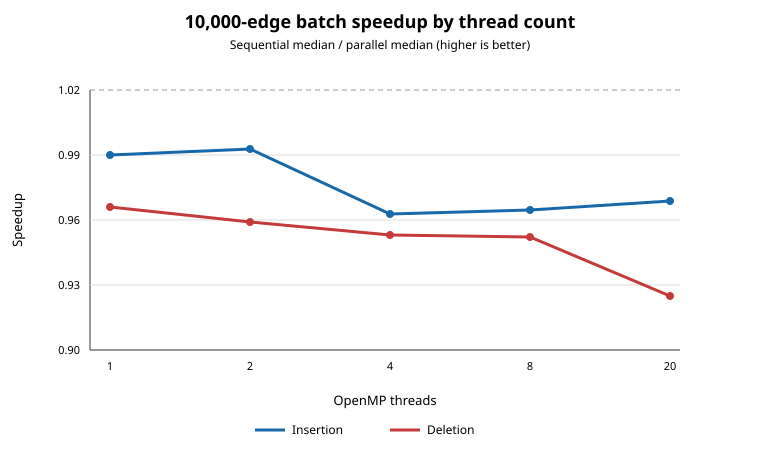

# CPU Batch Parallelism: Experimental Report

## Summary

This experiment adds opt-in OpenMP paths for batch edge insertion and
deletion. The paths parallelize endpoint-owned adjacency-list updates, then
run the existing seed discovery and κBCO/onion-layer maintenance sequentially.
They preserve the original sequential path as the default and reference.

On the tested DBLP update batches, the new path did **not** produce a
consistent speedup. At 10,000 edges, all measured parallel medians were slower
than the sequential median, with 20 threads giving 0.969x for insertion and
0.925x for deletion. This is expected for a parallelized fraction surrounded
by sequential maintenance and added grouping/merge overhead.

## Test setup and method

- Dataset: DBLP; the repository's 1,000-edge sample and a deterministic
  10,000-edge holdout generated from the same DBLP graph.
- Host: Linux, GCC 15.2, 20 logical CPUs, approximately 14 GiB RAM.
- Parallel implementation: OpenMP; `OMP_NUM_THREADS` set to 1, 2, 4, 8, or
  20. The 20-thread run is the maximum available logical CPU count on this
  host.
- Timing: three repetitions per operation, batch size, and thread count.
  Tables report the median query time in milliseconds; graph/index loading
  and output serialization are outside this timed query interval.
- Batch sizes: 1, 10, 100, 1,000, and 10,000 edges. The 10,000-edge results
  are from a separate valid holdout run. A preliminary 10,000-edge segment in
  the smaller-batch capture used an empty input due to a test-file path
  collision and is explicitly excluded.
- The original project baseline logs are retained unchanged. Those historical
  runs are not directly comparable to every batch size in this experiment.

The original DBLP index-build baseline remains: copy 133.197 ms, peeling
1,976.885 ms, and total indexing 2,854.409 ms. The historical sequential
dynamic-query baselines remain insertion 7.305 ms and deletion 5.136 ms.
These baseline values are reported for context, not mixed into the controlled
batch-size comparison below.

## Median query times

Each parallel column is the median across three runs. All values are
milliseconds.

| Operation | Batch | Sequential | Parallel 1 thread | 2 threads | 4 threads | 8 threads | 20 threads |
|---|---:|---:|---:|---:|---:|---:|---:|
| Insert | 1 | 0.009 | 0.026 | 0.020 | 0.020 | 0.022 | 0.022 |
| Insert | 10 | 4.574 | 4.680 | 4.654 | 4.617 | 4.586 | 4.672 |
| Insert | 100 | 5.545 | 5.846 | 6.022 | 5.689 | 5.752 | 5.578 |
| Insert | 1,000 | 7.949 | 8.167 | 8.264 | 8.272 | 8.821 | 9.890 |
| Insert | 10,000 | 78.322 | 79.152 | 78.900 | 81.299 | 81.152 | 80.798 |
| Delete | 1 | 0.727 | 0.765 | 0.739 | 0.751 | 0.775 | 0.783 |
| Delete | 10 | 0.777 | 0.734 | 0.757 | 0.750 | 0.741 | 0.765 |
| Delete | 100 | 1.951 | 2.029 | 1.965 | 2.098 | 1.929 | 1.943 |
| Delete | 1,000 | 5.460 | 5.575 | 5.824 | 6.159 | 6.484 | 6.685 |
| Delete | 10,000 | 96.842 | 100.222 | 100.934 | 101.618 | 101.694 | 104.640 |

## Speedup and parallel efficiency

Speedup is `sequential median / parallel median`; efficiency is
`speedup / thread count`. The following table gives both metrics for the
10,000-edge experiment, which is the largest tested batch.

| Operation | Threads | Speedup | Efficiency |
|---|---:|---:|---:|
| Insert | 1 | 0.990x | 99.0% |
| Insert | 2 | 0.993x | 49.6% |
| Insert | 4 | 0.963x | 24.1% |
| Insert | 8 | 0.965x | 12.1% |
| Insert | 20 | 0.969x | 4.8% |
| Delete | 1 | 0.966x | 96.6% |
| Delete | 2 | 0.959x | 48.0% |
| Delete | 4 | 0.953x | 23.8% |
| Delete | 8 | 0.952x | 11.9% |
| Delete | 20 | 0.925x | 4.6% |

The 20-thread speedup/efficiency for the other batch sizes was:

| Operation | Batch | Speedup | Efficiency |
|---|---:|---:|---:|
| Insert | 1 | 0.409x | 2.0% |
| Insert | 10 | 0.979x | 4.9% |
| Insert | 100 | 0.994x | 5.0% |
| Insert | 1,000 | 0.804x | 4.0% |
| Delete | 1 | 0.928x | 4.6% |
| Delete | 10 | 1.016x | 5.1% |
| Delete | 100 | 1.004x | 5.0% |
| Delete | 1,000 | 0.817x | 4.1% |

The marginal apparent gains for 10- and 100-edge deletion are smaller than
the run-to-run variation and should not be interpreted as a reliable
parallel speedup. For sub-millisecond batches, runtime and measurement
overhead are also a significant fraction of the result.

## CPU and memory observations

Whole-process measurements for the 10,000-edge runs (including loading and
index setup, unlike the query timings above) showed approximately 94% CPU
utilization in each configuration. Peak RSS was:

| Operation | Sequential peak RSS | 20-thread parallel peak RSS |
|---|---:|---:|
| Insert | 1,424,312 KiB | 1,423,608 KiB |
| Delete | 1,556,360 KiB | 1,556,436 KiB |

These process-level measurements show no meaningful memory increase from the
parallel path. Approximately one-core CPU utilization is consistent with the
large sequential portions; it is not evidence that the OpenMP endpoint phase
alone used only one core.

## CPU-parallel rerun (2026-11-04)

The available 1,000-edge DBLP sample was rerun against the same base/full
indexes with three repetitions per configuration. The sequential path was
compared with the OpenMP path at 1, 4, and 20 threads. Index loading and output
serialization were excluded from the reported query times. The host exposed
20 logical CPUs.

| Operation | Sequential median | Parallel 1 thread | Parallel 4 threads | Parallel 20 threads |
|---|---:|---:|---:|---:|
| Insert | 7.643 ms | 8.442 ms (0.905x) | 8.630 ms (0.886x) | 9.114 ms (0.839x) |
| Delete | 5.456 ms | 5.765 ms (0.946x) | 6.076 ms (0.898x) | 6.725 ms (0.811x) |

Speedup is sequential median divided by parallel median. With this workload,
using more CPU threads did not improve end-to-end batch time. The 20-thread
parallel insertion and deletion outputs were each byte-identical to the
expected full and base DBLP indexes, respectively. This rerun covers the
available 1,000-edge sample; it does not replace the earlier 10,000-edge
holdout experiment.

## Large-batch CPU-parallel rerun (2026-11-04)

To focus on larger updates, a deterministic 100,000-edge holdout was selected
from the DBLP full edge list. A matching base graph/index was made by removing
the holdout and rebuilding its index. The first 10,000 edges of that same
holdout were also tested: their matching starting index was generated by
deleting those edges from the full DBLP index. Thus each insertion restores
the full graph, and each deletion produces the corresponding reduced graph.

Each operation and batch size was run three times sequentially and with
OpenMP configured for 4 and 20 threads (`OMP_DYNAMIC=FALSE`). The host exposed
20 logical CPUs. Both update batches had at least 2,623 distinct U endpoints
and 8,371 distinct V endpoints, exceeding the implementation's threshold for
parallel endpoint-owned loops. Index loading and output serialization are
excluded from query timings.

The table reports median query time, speedup over sequential, and slowdown
relative to sequential:

| Operation | Batch | Sequential | Parallel 4 threads | Parallel 20 threads |
|---|---:|---:|---:|---:|
| Insert | 10,000 | 80.085 ms | 85.566 ms (0.936x, 6.8% slower) | 90.870 ms (0.881x, 13.5% slower) |
| Delete | 10,000 | 104.064 ms | 108.717 ms (0.957x, 4.5% slower) | 109.641 ms (0.949x, 5.4% slower) |
| Insert | 100,000 | 1,086.268 ms | 1,130.678 ms (0.961x, 4.1% slower) | 1,158.370 ms (0.938x, 6.6% slower) |
| Delete | 100,000 | 1,421.804 ms | 1,493.347 ms (0.952x, 5.0% slower) | 1,489.623 ms (0.954x, 4.8% slower) |

Speedup is sequential median divided by parallel median. Parallel mode was
slower in every tested large-batch configuration; 20 threads did not improve
on 4 threads for any operation/batch pair.

For both batch sizes and both operations, sequential and 20-thread parallel
saved indexes were byte-identical to each other. The 10,000-edge outputs also
matched the corresponding expected indexes byte-for-byte. At 100,000 edges,
the insertion output differs from a fresh full rebuild only in the aggregate
maximum-layer header (`l,61` incrementally versus `l,60` on rebuild); deletion
differs only in that header (`l,60` incrementally versus `l,56` on rebuild).
The remaining saved-index bytes match. This reproduces the previously noted
incremental-versus-rebuild maximum-layer metadata discrepancy at a larger
scale; it is not a parallel-versus-sequential difference.

## Correctness validation

- DBLP 1,000-edge insertion: sequential and parallel saved indexes were
  byte-identical and matched the full DBLP index.
- DBLP 1,000-edge deletion: sequential and parallel outputs were
  byte-identical and matched the base DBLP index.
- DBLP 10,000-edge insertion: sequential and parallel outputs were
  byte-identical and matched the full DBLP index.
- DBLP 10,000-edge deletion: sequential and parallel outputs were
  byte-identical and matched the 10,000-edge base index.
- Small and seeded-random graphs exercised empty and single-edge batches,
  duplicates, shared endpoints, new insertion vertex IDs, and deletion of
  absent edges. Parallel outputs matched the corresponding sequential
  incremental outputs.

One seeded-random case had a discrepancy between the existing sequential
incremental result and a fresh full rebuild's maximum-layer metadata. The
parallel path matched the sequential incremental result; this pre-existing
reference/rebuild discrepancy is not claimed as resolved by this work.

## Interpretation and limitations

The parallel work is restricted to safe adjacency maintenance. Insert/delete
seed discovery, candidate ordering, κ/core propagation, and onion-layer
maintenance remain sequential. This means the main computation is not yet
parallelized, and the controlled measurements show no end-to-end benefit for
the tested workloads. The extra grouping and bulk-merge/removal work can add
overhead, especially at larger thread counts.

The implementation should therefore be treated as an experimental,
correctness-preserving parallel adjacency path—not as a demonstrated
acceleration of κBCO-index maintenance. A future speedup requires a
level-synchronous, conflict-aware gather/reduce/apply design for seed
generation and maintenance frontiers, validated against the sequential
reference before deployment.
