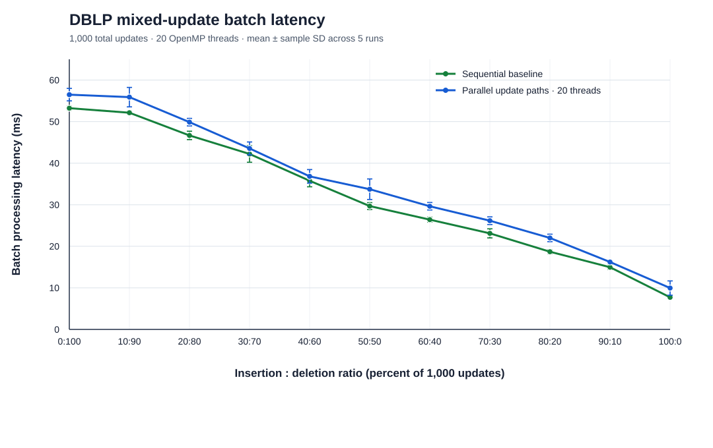

# DBLP Mixed-Update Ratio Results

## Summary

The total batch size was fixed at **1,000 updates** while the insertion to
deletion ratio varied from 100:0 to 0:100. Each ratio was run five times
through both the sequential update paths and the existing parallel update
paths configured for 20 OpenMP threads. Times are mean ± sample standard
deviation.

| Insert:delete | Updates (insert + delete) | Sequential batch time (ms) | Parallel batch time (ms) | Speedup | Parallel throughput (updates/s) | Sequential wall (s) | Parallel wall (s) |
|---:|---:|---:|---:|---:|---:|---:|---:|
| 100:0 | 1,000 + 0 | 7.722 ± 0.135 | 9.949 ± 1.719 | 0.776x | 100,517 | 1.540 ± 0.023 | 1.596 ± 0.020 |
| 90:10 | 900 + 100 | 14.963 ± 0.543 | 16.224 ± 0.190 | 0.922x | 61,639 | 3.158 ± 0.055 | 3.175 ± 0.019 |
| 80:20 | 800 + 200 | 18.693 ± 0.502 | 22.012 ± 0.892 | 0.849x | 45,429 | 3.101 ± 0.056 | 3.268 ± 0.044 |
| 70:30 | 700 + 300 | 23.118 ± 1.096 | 26.159 ± 0.916 | 0.884x | 38,227 | 3.126 ± 0.172 | 3.251 ± 0.152 |
| 60:40 | 600 + 400 | 26.414 ± 0.599 | 29.637 ± 0.894 | 0.891x | 33,741 | 3.034 ± 0.020 | 3.217 ± 0.050 |
| 50:50 | 500 + 500 | 29.677 ± 0.820 | 33.735 ± 2.474 | 0.880x | 29,643 | 3.116 ± 0.090 | 3.210 ± 0.057 |
| 40:60 | 400 + 600 | 35.773 ± 1.452 | 36.834 ± 1.634 | 0.971x | 27,149 | 3.144 ± 0.055 | 3.194 ± 0.048 |
| 30:70 | 300 + 700 | 42.219 ± 1.999 | 43.550 ± 1.547 | 0.969x | 22,962 | 3.211 ± 0.059 | 3.305 ± 0.044 |
| 20:80 | 200 + 800 | 46.680 ± 1.006 | 49.874 ± 0.905 | 0.936x | 20,050 | 3.210 ± 0.050 | 3.286 ± 0.015 |
| 10:90 | 100 + 900 | 52.140 ± 0.432 | 55.894 ± 2.343 | 0.933x | 17,891 | 3.212 ± 0.009 | 3.252 ± 0.019 |
| 0:100 | 0 + 1,000 | 53.233 ± 0.494 | 56.493 ± 1.496 | 0.942x | 17,701 | 1.648 ± 0.013 | 1.718 ± 0.020 |

Speedup is the five-run mean sequential batch time divided by the five-run
mean parallel batch time. Throughput is 1,000 updates divided by the mean
parallel batch time. The parallel path was slower than the sequential path
for every ratio on this workload.

## Execution time versus ratio

The figure plots mean algorithm-reported batch processing latency with
sample-standard-deviation error bars for the sequential baseline and the
20-thread parallel paths. Latency rises as the deletion share increases for
the selected DBLP updates. The parallel path remains slower at each ratio;
the gap narrows for deletion-heavy cases, but those gains are not achieved in
these measurements.

## Workload and measurement method

- Starting graph/index: DBLP `base.txt` / `base.index` (12,281,059 edges).
- Insertion candidates: the 1,000 edges in `data/dblp/sample.txt`, which are
  absent from the base graph.
- Deletion candidates: 1,000 edges sampled from `data/dblp/base.txt` using
  reservoir sampling with Python `random.Random(20261106)`. The exact
  deletion list is [DBLP_MIXED_DELETE_UPDATES.txt](./DBLP_MIXED_DELETE_UPDATES.txt).
- The insertion and deletion candidate sets are disjoint. Each ratio uses a
  prefix of each fixed candidate sequence, and the total number of updates
  always equals 1,000.
- For each ratio, insertions are applied first and deletions second, starting
  from the same base index. This ordering keeps both update sets valid and
  defines one reproducible mixed workload.
- The sequential baseline calls the existing sequential insert and delete
  paths. The parallel run enables `BI_CORE_PARALLEL=1` and configures
  `OMP_NUM_THREADS=20`, `OMP_THREAD_LIMIT=20`, and `OMP_DYNAMIC=FALSE`.
- The repository has separate insertion and deletion executables, not a
  native PBM mixed-batch entry point. Accordingly, a mixed parallel batch
  here is the sum of the parallel insertion and deletion path latencies,
  applied serially in the stated order; it is not simultaneous mixed-update
  processing.
- Batch time is the sum of the executables' reported `Total query time`
  values. End-to-end wall time in the table includes process startup and
  index/update loading and saving. Mixed cases invoke both executables and
  therefore perform an intermediate index load/save; the 100:0 and 0:100
  cases invoke only one.
- Compiler: GCC 15.2, `-O3`, C++0x mode, OpenMP. Host: Intel Core
  i7-13650HX, 14 physical cores, 20 logical CPUs.
- Every one of the 55 parallel final indexes matched the corresponding
  sequential final index byte-for-byte. The 100:0 output also matched
  `data/dblp/full.index`.

The measured time depends on both the update ratio and the specific edges
selected: different deletions can trigger different amounts of core-index
maintenance. Results should therefore be interpreted for this fixed DBLP
candidate sequence, not as a ratio-only law across arbitrary graphs.

## Raw results

The 55 per-run measurements, including sequential and parallel batch times,
end-to-end times, update counts, and correctness status, are available in
[DBLP_MIXED_RATIO_RAW.csv](./DBLP_MIXED_RATIO_RAW.csv).
